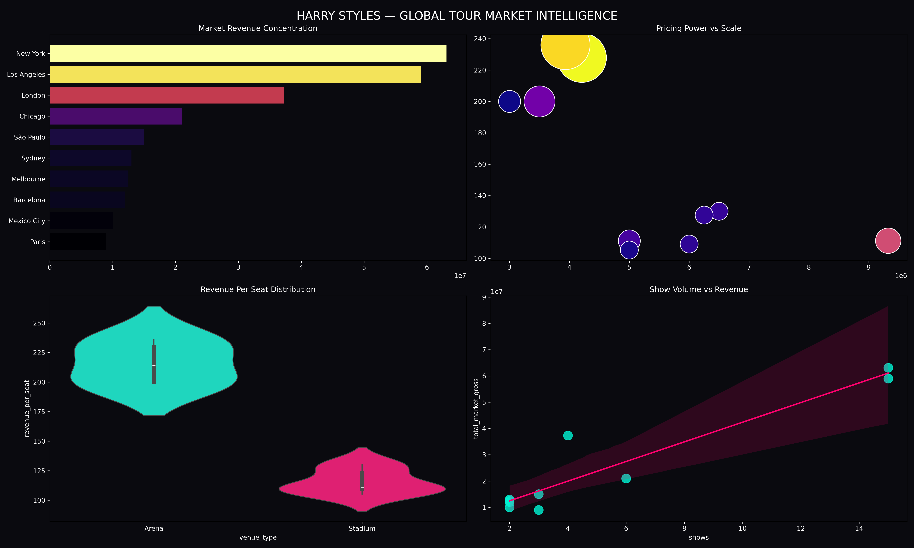
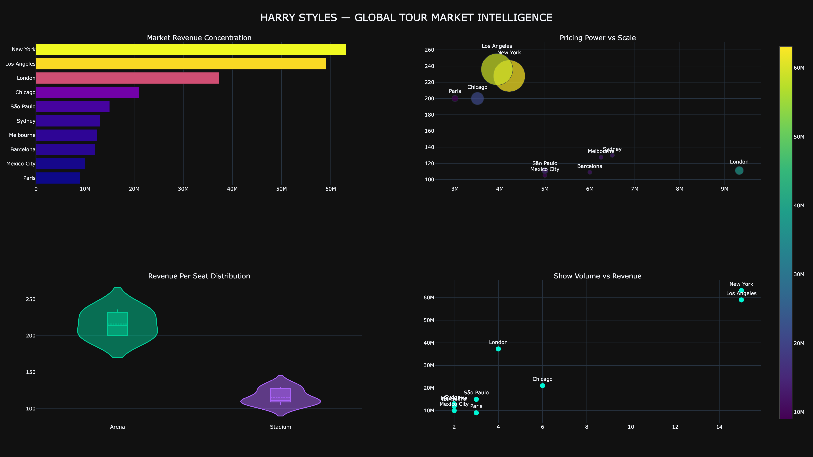

# Harry Styles Global Tour Market Intelligence

> Where does a global tour make its money, and does arena or stadium strategy win on pricing power?


**Independent analytics project. No affiliation with Harry Styles or his team.**



## The question

How do global markets perform structurally (arena vs stadium, region vs region), and where are revenue concentration and pricing power strongest?

## What I did

- Cleaned the Love On Tour gross and ticket data and the 2026 Together Together tour structure (venues, capacity, shows).
- Built metrics in Python and SQLite: gross per show, **revenue per seat**, total market gross and market share by city.
- Compared **arena vs stadium** economics and benchmarked US, Europe, LATAM and Australia.
- Ran a scenario test: a 10% ticket price increase and a New York risk case.
- Built a static dashboard (Matplotlib and Seaborn) and an interactive one (Plotly).

## What the data showed

| Finding | Evidence |
|---|---|
| Revenue is concentrated in a few cities | New York and Los Angeles lead (roughly 63M and 59M USD gross), with London third (roughly 37M). Read off the dashboard chart. |
| Arenas win on pricing power | Arena revenue per seat clusters around 200 to 250 USD. Stadiums sit around 105 to 130 USD. |
| Stadiums win on scale | Large stadium runs carry total gross, so scale comes from capacity, not price. |
| Revenue is highly price-leveraged | In the scenario test, a 10% price increase lifted revenue by about 10%, assuming ticket volume stays the same. |

## Honest limits

- It is a small sample of markets (about ten cities), so regional claims are directional.
- The price scenario assumes demand does not change when prices rise. Real demand would respond.
- The data is tour gross and ticket figures, so it says nothing about costs or profit.
- Scenario results are what-ifs, not forecasts.

## Files

| Path | What it is |
|---|---|
| `harry_styles_analysis.py` | Main script: cleaning, SQLite, metrics, static dashboard |
| `harry_styles_plotly_dashboard.py` | Interactive Plotly dashboard |
| `data/` | The two Excel datasets (Love On Tour, Together Together) |
| `docs/` | Project summary PDF |
| `images/` | Dashboard exports |

## How to run

```bash
git clone https://github.com/iguesshecodes/harry-styles-tour-analytics.git
cd harry-styles-tour-analytics
pip install -r requirements.txt
python harry_styles_analysis.py
python harry_styles_plotly_dashboard.py
```

## Interactive version



## Contact

[LinkedIn](https://www.linkedin.com/in/vareshnirbhavne) | [Portfolio](https://vareshportfolio.vercel.app) | vareshworks@gmail.com
